<p align="center">
  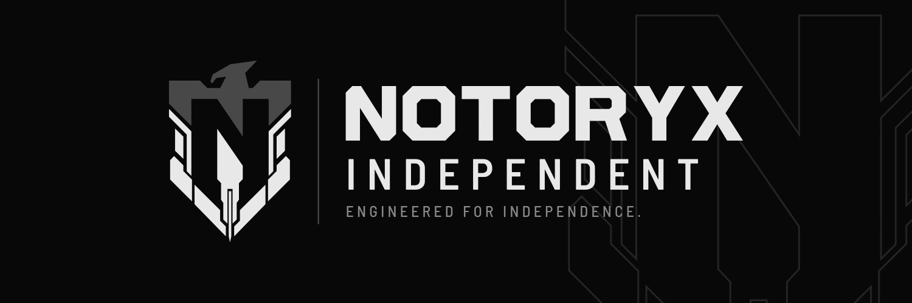
</p>

# NOTORYX Independent downloads

**Off-grid messaging over your MeshCore LoRa radio.** Part of the **NOTORYX** off-grid communications family. **No Towers. No Limits.**

This repository hosts builds of NOTORYX Independent, the new from-scratch edition of NOTORYX Core, for Android, Mac and Windows. Get them from **[Releases](../../releases)**.

<table>
  <tr>
    <td>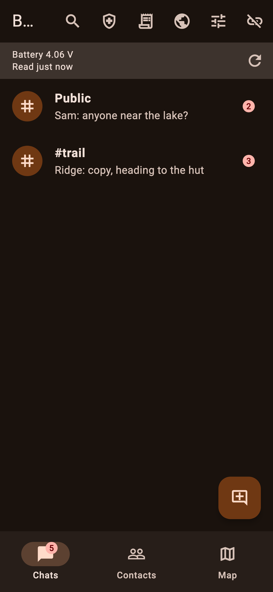</td>
    <td>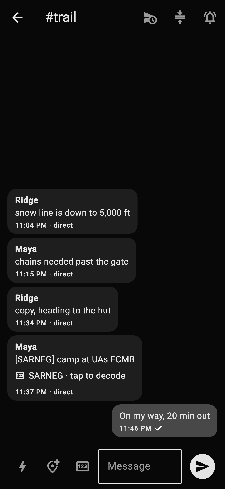</td>
    <td>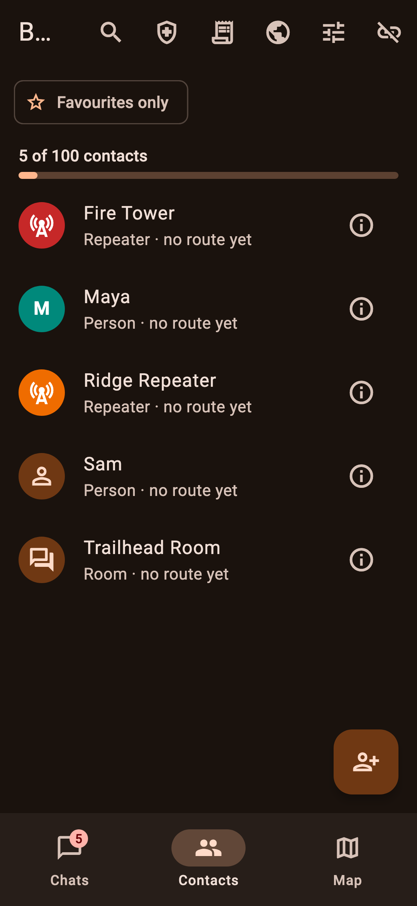</td>
  </tr>
  <tr>
    <td>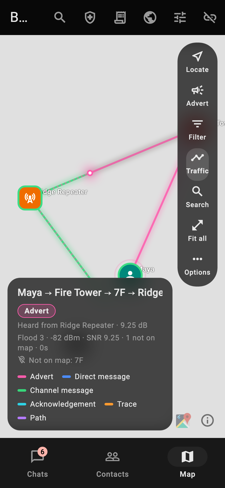</td>
    <td>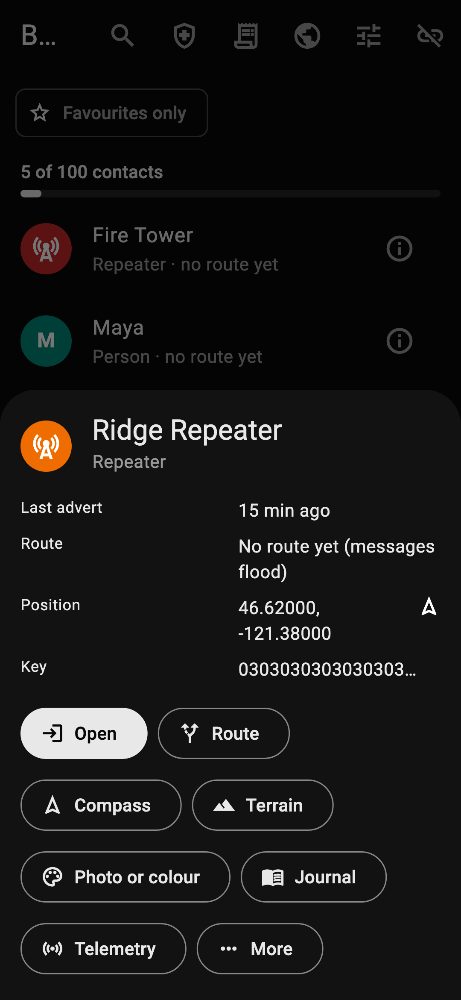</td>
    <td>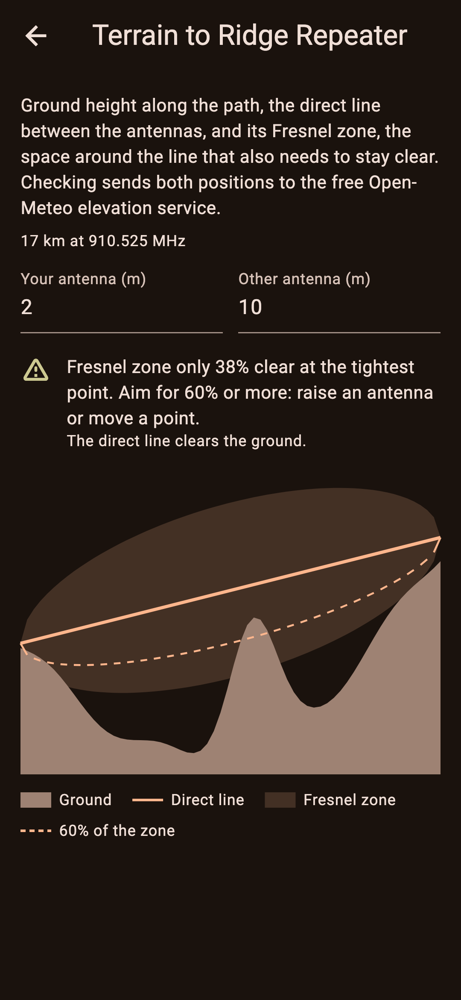</td>
  </tr>
  <tr>
    <td>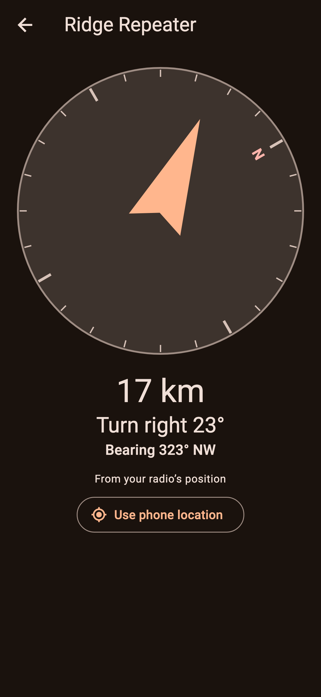</td>
    <td>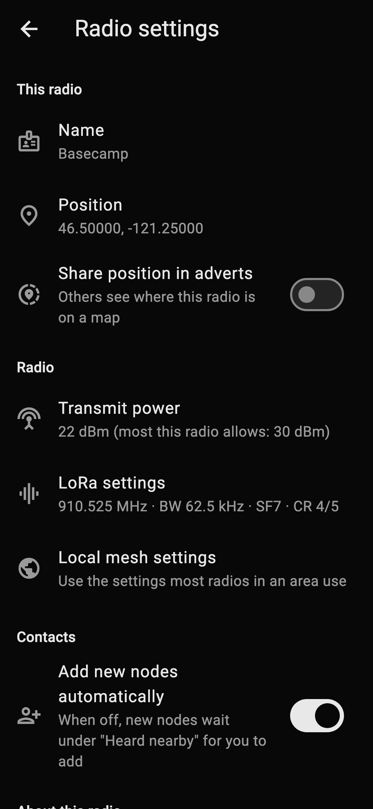</td>
    <td>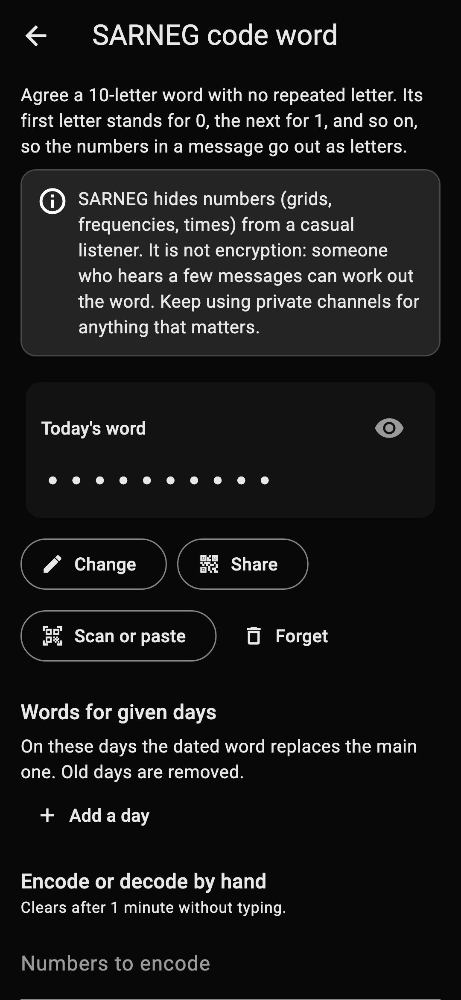</td>
  </tr>
  <tr>
    <td>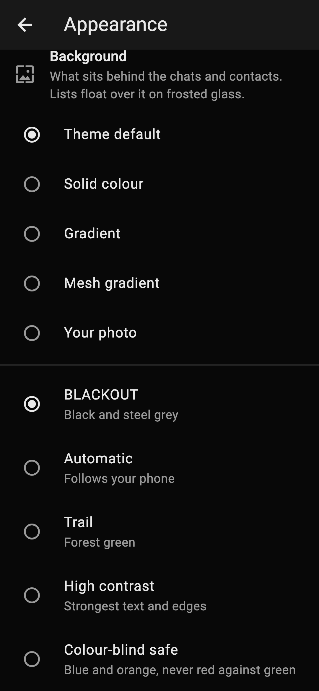</td>
    <td>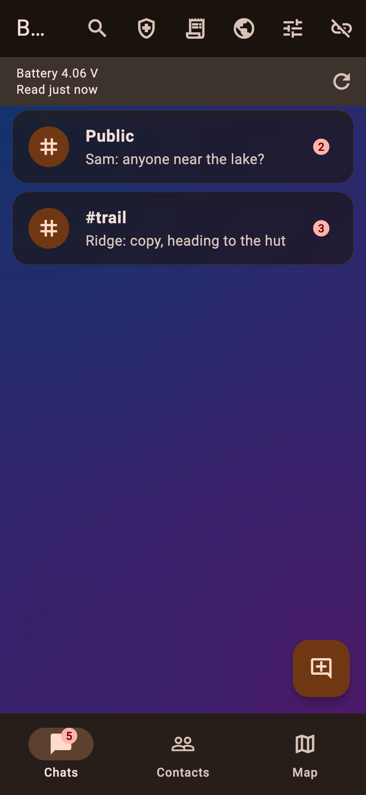</td>
    <td><sub>Screens in the default BLACKOUT theme, with a test radio and made-up names and places. BLACKOUT has been the default since test 38.</sub></td>
  </tr>
</table>

## Status: in development, test builds out

This edition of NOTORYX Core is being written from scratch (MIT licensed). Until it matches the current app's features, the current NOTORYX Core keeps shipping from [notoryx-core-releases](https://github.com/TheLogsAreScreaming/notoryx-core-releases) and stays the one to use every day.

Progress so far:

| Part | State |
|---|---|
| Radio protocol (commands and replies) | Done |
| Command queue and Wi-Fi (TCP) connection | Done |
| Bluetooth connection | Done |
| USB connection (Android; Mac later) | Done |
| Contacts, messages and channels | Done |
| Connect, chats, contacts and conversation screens | Done |
| Reliable direct messages (retries, flood fallback, resend) | Done |
| Automatic reconnect (at launch and after a drop) | Works on Mac; fixing Android |
| Unread counts, muting and notifications | Done |
| Add, share and manage contacts and channels | Done |
| Radio settings and local mesh presets | Done |
| Local mesh settings (suggests your area's radio settings) | Done |
| Map and node details | Done |
| QR codes for contacts and channels | Done |
| Repeater and room tools (log in, status, console) | Done |
| Message search | Done |
| Delivery details for sent messages | Done |
| Staying connected in the background (Android) | Done, needs a phone test |
| Path trace and path trace on the map (tap a node to see its route) | Done |
| Packet log (everything the radio hears) | Done |
| Smaller phone-only Android download | Done |
| Map works offline where you've looked | Done |
| Telemetry history (battery and sensors over time) | Done |
| Quick messages and drafts | Done |
| Reactions and replies | Done |
| SOS (hold to send, repeats until answered, I'm safe) | Done |
| Check-ins: four kinds, trip contacts, who it reached, quiet warnings | Done |
| Noise floor history | Done, needs a radio test |
| Contact meter and making room for new contacts | Done |
| Automatic updates with Obtainium | Done |
| About screen with details for problem reports | Done |
| Encrypted backup and restore | Done |
| Block senders, highlight mentions | Done |
| Find channels (heard on air, near you, directory) | Done, needs a radio test |
| Share a position or contact in chat | Done |
| Track log with GPX export, sensor badges on the map | Done, needs a phone test |
| Repeater ping, neighbors and access control | Done, needs a radio test |
| Antenna hunt | Done, needs a radio test |
| Command line for your own radio, Wi-Fi setup | Done, needs a radio test |
| Your radio's battery and sensors on the home screen, refresh rate | Done, needs a radio test |
| Themes and chat text size | Done |
| Add contacts from an advert or key, or several at once | Done, needs a radio test |
| Auto-delete old channel messages, hide repeated posts | Done |
| Forget last advert time | Done, needs a radio test |
| Trip brief and Field Log | Done, needs a radio test |
| Field guide | Done |
| App-icon shortcuts (Android) | Done, needs a phone test |
| Separate Bluetooth and app logs | Done |
| Full app and menus with or without a radio | Done, checked on a phone |
| Trusted contact's command line | Done, needs a radio test |
| Channel post regions (real region scoping) | Done, needs a radio test |
| SALUTE and 9-Line reports | Done, needs a radio test |
| Message forwarding and scheduled messages | Done, needs a radio test |
| Auto-replies and away messages | Done, needs a radio test |
| App lock (fingerprint, face or screen lock) | Done, needs a phone test |
| Encrypted chat history | Done, needs a phone test |
| Repeater IDs and region setup | Done, needs a radio test |
| Community radio presets by country | Done |
| Android home-screen widget | Done, needs a phone test |
| Screen-reader checks | Automated checks on every settings screen, all five themes and large text; still needs a TalkBack check |
| Read aloud | Done, needs a phone test |
| 18 languages (AI-translated) and language picker | Done; every language checked on a phone for layout, wording still needs native speakers |
| SOS relay | Done, needs a two-radio test |
| Windows download | Builds; untested on a real PC |
| Signed SOS and channel posts | Done, needs a two-radio test |
| Bot commands (!ping, !sun, !moon, !dice) | Done, needs a radio test |
| Wardrive and coverage map | Done, needs a field test |
| Network scan across presets | Done, needs a supervised radio test |
| Path graph | Done, needs a radio test |
| MQTT bridge (packet feed) | Done, needs a real broker test |
| USB radios on Mac | Done, needs a radio test |
| Link previews (tap to load) | Done |
| On-device translation (Android, iPhone) | Done, needs a phone test |
| Tiny photos over the mesh | Done, needs a two-radio test |
| Images and GIFs from links (tap to load) | Done |
| Community moderation (NOTORYX Sentinel, opt-in) | Done, needs a phone test |
| Route view, route picker and network view | Done, needs a radio test |
| Nearby repeater test | Done, needs a radio test |
| Zone and trail alerts, favourites-only filter | Done, needs a phone test |
| Identity key backup and repeater names | Done, needs a radio test |
| Node journal, trace cards and timeline | Done, needs a radio test |
| Offline map packs (your own MBTiles) | Done, needs a phone test |
| Observer reach (which listening stations heard you) | Done, needs a live-server test |
| Area-limited channel posts (experimental, flood-corridor firmware) | Done, needs a radio test |
| Terrain and Fresnel zone check | Done, checked on a phone |
| Compass arrow to a node | Done, checked on a phone |
| Photo or colour per node | Done, colours checked on a phone |
| Backgrounds with frosted-glass lists | Done, checked on a phone |
| Live Traffic map (packets drawn hop by hop) | Done, checked with a real radio |
| Stale-node badge and range rings | Done, checked on a phone with a radio |
| SARNEG code words (auto-clear, Random word, well-known word warning) | Done, checked on a phone |
| SARNEG screens hidden from screenshots (Android) | Done, checked on a phone |
| Copied SARNEG text cleared after a minute, even if Android closed the app | Done, checked on a phone |
| Settings kept on the phone open without a radio (SARNEG, Appearance, Backup and more) | Done, checked on a phone |
| MeshCore fixes: channel message length, messages left on the radio, full contact list warning | Done, needs a radio test |
| BLACKOUT icon and theme (default), five themes in all | Done, checked on a phone |
| Reachability label for contacts | Done |
| Who Relays Me screen | Done |
| Relay attribution badge on messages | Done |
| In-app nRF52 firmware updates over Bluetooth (Nordic DFU) | Done, needs a radio test |
| Deep-link sharing (open a contact or position from a link or QR code) | Done |
| iPhone | Compiles in CI; needs an Apple developer account |

The latest test build is **[0.1.0 test 53](../../releases/tag/v0.1.0-test.53)** (28 November 2026). Tests 52 and 53 added sorting chats by most-recent message, scrolling to oldest unread, a CLI firmware guard and confirmation for destructive commands, a **reachability label** for contacts, telemetry subscribe on connect (firmware v1.18+), **in-app nRF52 firmware updates** over Bluetooth (Nordic DFU), a **Who Relays Me** screen, a **relay attribution badge** on messages, **deep-link sharing** so you can open a contact or a position from a link or QR code, and **path trace on the map** so you can tap a node and see the route its messages took.

Since test 37:

- **Test 38:** the BLACKOUT icon and theme, now the default. Light, Dark, Night and Lake are gone; anyone who used one moves to BLACKOUT.
- **Tests 39 and 40:** SARNEG screens are hidden from screenshots on Android, plus more SARNEG options: keep the grid zone in clear, send without the marker, delete words after a day, SARDOT, number and letter of the day, and a guide on SARNEG versus real encryption.
- **Test 41:** settings kept on the phone open without a radio, a plain message when another app holds the radio, MeshCore protocol fixes, "Last hop" on the Traffic map, report status for community moderation, and accessibility fixes.
- **Tests 42 and 43:** copied SARNEG text is cleared by Android itself, so it still happens if the app has been closed. If you allow exact alarms for the app in SARNEG → Options, it clears on the minute.
- **Tests 52 and 53:** sort chats by most recent, scroll to oldest unread, CLI firmware guard and destructive-command confirmation, reachability label, telemetry subscribe on connect, in-app nRF52 OTA via Nordic DFU, Who Relays Me screen, relay attribution badge, deep-link sharing, path trace on the map.

Some keyboards, including Samsung's, keep their own clipboard history and ignore the request not to. No app can clear another app's history, so clear it in the keyboard if you need to.

## Which Android file?

- `…-android-arm64.apk` (about 54 MB): almost every phone since 2017. Start here.
- `…-android.apk` (about 150 MB): older 32-bit phones, Chromebooks and emulators.

Both have the same version and signature, so either updates the other in place.

## Automatic updates (Obtainium)

[Obtainium](https://github.com/ImranR98/Obtainium) can install new Android builds from here as they come out:

1. In Obtainium, tap **Add App**.
2. **App source URL:** `https://github.com/TheLogsAreScreaming/notoryx-core-independent-releases`
3. Turn on **Include prereleases**. Every test build is a pre-release, so without this Obtainium finds nothing.
4. **Filter APKs by regular expression:** `arm64` for most phones, or `android\.apk$` for the full build.
5. Tap **Add**, then **Install**. A copy you installed by hand gets updated too, because the signing key is the same.

This works from test 15 on. Earlier builds all reported version `0.1.0`, so Obtainium couldn't tell them apart.

## Installs alongside the current app

The new app has its own app ID, so you can keep both installed. It shows up as **NOTORYX Independent**, with the steel BLACKOUT eagle-N icon from test 38 on (earlier builds had a silver NOTORYX icon).

| | Current NOTORYX Core | NOTORYX Independent |
|---|---|---|
| Android app ID | `com.bastionmesh.bastion` | `com.bastionmesh.notoryx_core` |
| Mac bundle ID | `com.bastionmesh.bastion` | `com.bastionmesh.notoryxCore` |
| Downloads | [notoryx-core-releases](https://github.com/TheLogsAreScreaming/notoryx-core-releases) | here |

The two apps don't share data. Contacts and channels stored on your radio show up in both, because they live on the radio.

## Installing a build

Each release includes:

- **Android:** an `.apk`. Open it on your phone and allow installs from your browser or file manager if asked.
- **Mac** (Intel and Apple silicon, macOS 12 or newer): a `.zip` with the app. Unzip it, move it to Applications, and the first time right-click it and choose **Open** (it isn't notarized yet). Allow Bluetooth when asked.
- **Windows:** a `.zip` with the app. Unzip it anywhere and run `notoryx_independent.exe`. It isn't signed, so Windows may warn you first. Not yet tested on a real PC.
- **Checksums:** a `SHA256SUMS.txt` file, so you can confirm a download wasn't changed:

```bash
shasum -a 256 -c SHA256SUMS.txt
```

Builds marked **Pre-release** are for testing and may have bugs.

Android builds are signed with the NOTORYX Independent release key (certificate SHA-256 `2a3e26c01231a764fb398ef4fd844f8a0b782228013b1aba5a10c41ac3500924`), so each new build updates the previous one in place.

## Works with

[MeshCore](https://meshcore.io/) companion radios over Bluetooth, USB or Wi-Fi. Firmware v1.18 is the main target; older firmware is supported where the protocol allows.

## Local mesh settings

[`regional_presets.json`](regional_presets.json) lists areas whose meshes use different radio settings from the usual ones for their part of the world, such as Phoenix on 908.205 MHz / 62.5 / SF9. Most are worked out from the public [MeshCore map](https://map.meshcore.io), where node owners report their settings, so they aren't checked on air. The app checks this file at launch and also ships a built-in copy. If your area is missing or wrong, [open an issue](../../issues/new) and say where the settings come from.

## Reporting problems

Open an issue in this repository with your phone or Mac model, the app version (from the About screen), your radio model and its firmware version.
